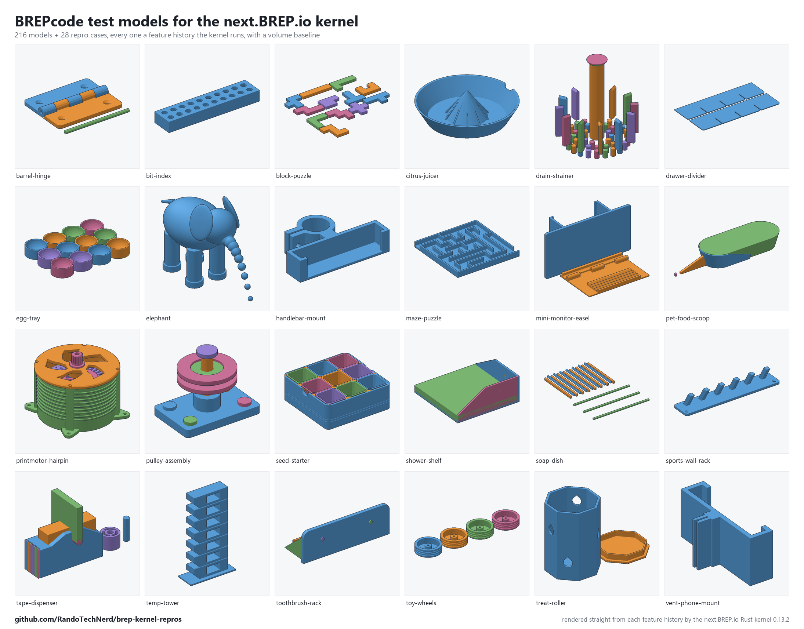

# BREPcode test models for the next.BREP.io kernel

Every model BREPcode uses to test the next.BREP.io Rust kernel, as the feature
histories the kernel executes. There are two sets:

- **`models/`**: all 216 BREPcode catalog models at their default sizes and the
  example scripts, each checked against a recorded volume. It's a regression
  suite: a model that stops building, or changes volume, shows up.
- **`cases/`**: small models that each pin down one behaviour, with the right
  answer worked out in closed form. Most of them sit in a pair: one the kernel
  refuses, and a passing control next to it, so the difference shows what
  triggers the refusal.



More sheets: [catalog 1](previews/catalog-1.png), [2](previews/catalog-2.png),
[3](previews/catalog-3.png), [4](previews/catalog-4.png), [5](previews/catalog-5.png),
[examples](previews/examples.png), [repro cases](previews/cases.png). Every tile is
rendered from the history in this repo by the kernel itself (0.13.2). Models with
mesh steps show only the part the kernel builds.

Every file is exactly what was passed to `execute_history_json`, compiled by
BREPcode (brepcode.com) to the kernel's own feature dialect. Running them needs
nothing from BREPcode.

## Running them

```bash
node run.mjs <kernel dir>                    # everything
node run.mjs <kernel dir> cases              # just the cases
node run.mjs <kernel dir> models             # just the models
node run.mjs <kernel dir> cases thin-lens    # one case (or a model id)
node run.mjs <kernel dir> models --baseline  # re-record models/baseline.json
```

`<kernel dir>` is a `wasm-pack --target web` build of the kernel (the folder
with `brep_kernel.js` and `brep_kernel_bg.wasm`). Node 18 or later. The runner
reads each result's exact volume with `mass_properties_handle`.

Results for 0.13.2 and 0.11.0 are in `results/`.

| | 0.13.2 | 0.11.0 |
|---|---:|---:|
| Models that build and match the baseline | 215 / 216 | 208 / 216 |
| Cases passing | 15 / 28 | 15 / 28 |

The baseline was recorded on 0.13.2. On 0.11, six catalog models refuse
(mug-tree, citrus-juicer, hose-guide, shelf-pin, game-dice, visor-clip) and two
differ in volume (jump-rope-handles 4.8%, self-watering-planter 0.06%).

## models/

```
models/index.json              every model: features, mesh steps, anything refused
models/baseline.json           volume and solid count per model (0.13.2)
models/catalog/<id>.json       the history
models/catalog/<id>.brepcode.js  the BREPcode source it came from, for reference
models/examples/...            the same for the example scripts
```

BREPcode splits a model between two lanes. Anything that never reads a mesh
goes to the kernel; a few operations (hull, texture, rounded offsets) run on a
mesh afterwards. For the 60 models that have mesh steps, the history here is
the exact-kernel part only, which is the part that matters for the kernel.
`index.json` gives the count as `meshSteps`.

On 0.13.2, one model is refused:

- `examples/printmotor-assembly` (621 features): `B517` union fails with
  "unsupported tangent-curve surface intersection", where two carriers touch
  along a 0.01 mm tangent curve.

## cases/

### Deleting a chamfer face where chamfers meet at a corner

A 40 x 30 x 20 block with its four top edges chamfered 3 mm, then `DF`. The
kernel refuses with "moved edge leaves face". Chamfers on the upright edges,
which never meet, delete fine, and so do fillets.

| Case | 0.13.2 |
|---|---|
| `delete-top-chamfer-faces`, `delete-one-top-chamfer-face` | refused |
| `step-delete-top-chamfer-faces`, `step-delete-one-top-chamfer-face` | refused (the same block, read in from `part.step`) |
| `delete-upright-chamfer-faces-control`, `delete-one-upright-chamfer-face-control` | pass, 24000 mm³ |
| `delete-fillet-faces-control` | pass, 24000 mm³ |
| `step-delete-*-control` | pass |

### Intersecting with a box that only touches on a face

`intersect-face-touching`: the block (x 0 to 40) intersected with a box at
x -50 to 0. The answer is empty. Instead the kernel refuses with "operation
produced no boundary faces". The controls, `intersect-shared-planes-control`
and `intersect-box-starting-on-face-control`, pass.

### Fillet meets chamfer at a corner

A block with its upright edges filleted r3 and its top edges chamfered 2. The
chamfer runs round the fillets, which leaves a free-form patch at each corner.

| Case | 0.13.2 |
|---|---|
| `fillet-chamfer-corner-delete-fillets` | passes |
| `fillet-chamfer-corner-delete-chamfers` | refused: "the extension folds back" |
| `fillet-chamfer-corner-tilt-side` | refused |
| `tilt-side-beside-fillet` | refused too, with no chamfer at all: the tilted face is bounded by a ruling of a fillet |
| `tilt-side-plain-block-control` | passes |

So the tilt refusal comes from the fillet beside the face, not from the corner
patch.

### Edge names only resolve in the kernel's order

`edge-name-reversed-order` names the same four edges as `B|A` instead of the
kernel's `A|B` and is refused. `edge-name-kernel-order-control` passes. This is
an API nicety, not a bug.

### Near-tangent cases (from brep-bench)

These four are from [brep-bench](https://github.com/bmander/brep-bench)'s
`cases/tangent/`, with closed-form volumes. Each has a control with the gap a
thousand times wider, and every control passes.

| Case | Gap | 0.13.2 |
|---|---|---|
| `tangent-bore-a-micron-from-the-wall` | a 1e-6 wall | refused (internal tangency) |
| `tangent-hairline-slot` | a 1e-6 saw cut | refused (non-integral genus) |
| `tangent-thin-lens` | a 1e-6 overlap | refused (no boundary faces) |
| `tangent-wedge-a-millionth-steep` | a 1e-6 slope | refused (no boundary faces) |

These are deliberately extreme, so a refusal is reasonable. A thin result
would be better.

Each case folder has `case.json` (what it is, the check, the expected answer)
and one history per step (`block.json`, `result.json`). The `step-` cases also
carry `part.step`.

## Not included

- brep-bench's tumbling torus (a torus swept while it turns): the kernel has no
  sweep of a solid, so there's no history to give.
- A few example scripts that are ES modules for BREPcode's CLI, and the
  catalog's seedling-tray, which never reaches the exact kernel.
